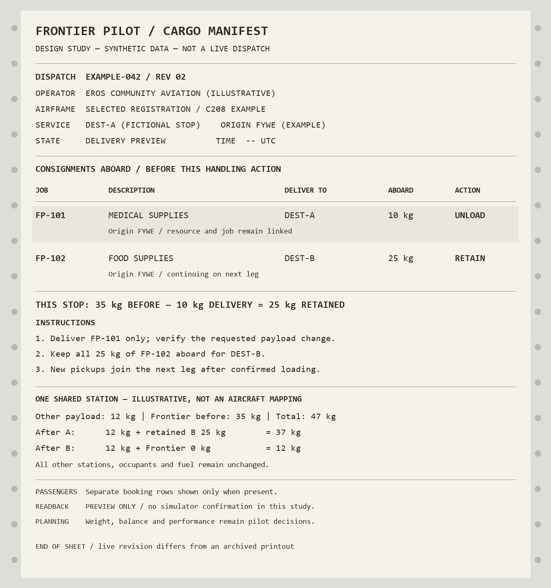

# Cargo loading, multi-job logistics and dispatch manifest investigation

**2026-10-29 · investigation/design only · no production behavior changed**

## Recommendation

Extend the existing shipment/transfer architecture. It already distinguishes **what is being carried** from **where its mass sits in MSFS**. Do not replace it with generic cargo mass or create an object for every kilogram.

The smallest useful upgrade is explicit per-shipment load/unload selection, followed by an aircraft manifest independent of a single route, and leg-scoped flight evidence. Keep existing inventory transactions, durable payload intents and once-only settlement. Introduce mixed passenger/cargo ownership only after those pieces work. Present a live consignment list in the loader and a read-only, versioned dispatch sheet alongside it.

The requested pilot-responsibility policy conflicts with some current code: the normal desired-state cargo planner rejects reported maximum gross/payload exceedance; PR #3's passenger path also rejects gross/payload exceedance and out-of-envelope CG. These are **application decisions**, not evidence that SimConnect itself refuses those weights. A future approved implementation should make operational ratings advisory while retaining genuine simulator station/interface restrictions. No gate has been removed here.

## Scope and evidence

| Inspected source | Exact state | Interpretation |
|---|---|---|
| Remote `master` | `d5ff51650789e45e46c8828893acaba071d957e7`, fetched during investigation | Shipped development foundation: cargo, grouped same-route transfers, wages, fleet; economy schema 10 |
| Current Offshore/shared-passenger development | `codex/offshore-career`, `f7df3ffffa620d39d55b36c7cb74d44805e1ab91`; [draft PR #3](https://github.com/MoneyWithMatt/frontier-pilot/pull/3), unmerged | Primary detailed source below; schema 12; shared physical passenger candidate and interim mixed-load guards |
| Destination research | `codex/starter-destination-research`, `6a6bfc723ace99ed5ebca2b1d991455a507bb2c4`; [draft PR #4](https://github.com/MoneyWithMatt/frontier-pilot/pull/4), unmerged | Research only; diff against master contains no `src/` or `tests/` changes. Do not treat suggested destinations/runways as simulator acceptance |

All source/test links below are pinned to PR #3's inspected commit. Cargo's `AircraftLoading.cs`, economy shipment concepts and same-route batching already exist on master; the passenger system and its guards are additional unmerged work. Historical V0 documentation sometimes says loading is simulated or one job is active; current code/tests supersede those descriptions. [Source index](sources.md) gives exact models/methods/test anchors.

Evidence levels: **code/tested** means the inspected implementation or synthetic regression supports the statement; **source deduction** identifies a consequence not exercised as a new scenario; **live unverified** means simulator behavior has not been demonstrated by this investigation. No personal saves or live telemetry were used. Existing cargo acceptance notes are historical, aircraft/version-specific evidence, not proof of the proposed multi-stop system.

## A. Current implementation

### A1. Jobs, availability and resource identity

`EconomyJob` references a `TransportRequirement` and planned `ShipmentId`. A `Shipment` already has its own ID, job/resource IDs, total quantity, origin/destination, state, current-location field, loaded/delivered/forfeited quantities and delivery receipt. `ResourceType` provides name/category/unit. Logical cargo is therefore a **job-associated resource consignment plus audited inventory movements**, not just mass. `CargoJobDisplay` joins the requirement, resource and shipment for UI presentation. [Models][S01], [presentation][S02].

`EconomyKernel.AcceptJob` atomically deducts the full requirement quantity from available origin inventory, creates one reserved shipment at that origin, reserves the requirement and records `ShipmentReserved` in the inventory ledger. Repeating acceptance is a no-op. That quantity is now reserved stock; loading it later must **not deduct origin available inventory a second time**. `EmployedCargoJobsService.AcceptAsync` and its command do not impose a single-active-job or aircraft-empty requirement. Additional jobs can be accepted while another is carried, subject to stock, offer validity and company assignment policy. [Acceptance][S03], [service][S04], [multi-reservation tests][T01], [restart test][T02].

`ActiveJob` is a selected/representative projection. It is not the entire reservation collection: `ReservedJobs` contains all accepted work. Accepted/loaded/in-transit SYSTEM jobs survive offer expiry; unaccepted offers alone expire. Company generation primarily supplies the employer's configured base-to-destination routes. Generic/player-operation contracts can have other origins, but accepting work anywhere does not itself generate new outstation cargo. [Board/presentation][S02], [company generation][S05], [UTC rules][S06].

Current flown resources are represented as kg by the cargo UI and loading bridge (`requirement.Quantity` becomes `CargoMassKilograms`). The resource model's unit string is generic; there is no general item-count/volume-to-mass conversion in this path. Do not interpret a future non-kg resource quantity as kilograms automatically. [Models][S01], [projection][S02].

### A2. Loading and the current logical/physical separation

The user selects reserved jobs and prepares them. `PrepareReservedJobsAsync`, `SelectJobsAsync` and the tracker's batch transfer path require **the same origin and destination**. Prepared jobs must be reserved or pre-departure loaded. A different route can remain accepted, but cannot join the prepared load; cargo already underway blocks switching to another route. Two same-route jobs can share one physical flight, keep separate shipment records and settle independently. [UI preparation][S07], [tracker selection][S08], [batch transfer][S09], [same-route proof test][T03], [different-route rejection test][T04].

`CargoLoadManifest.Shipments` contains `ManifestShipmentCargo` rows with job/shipment IDs and quantities. Its `Stations` independently hold per-station unmanaged baseline, Frontier mass, absolute target and readback. This is already the required conceptual separation: MSFS sees aggregate station weight, while Frontier keeps consignment identity. There is **no matrix linking each individual consignment's mass to individual stations** yet. [Manifest models][S10].

The current editor requests **total desired Frontier kg per station**. `CreateDesiredState` preserves unrelated payload by subtracting the old managed contribution from observed station mass and adding the new desired amount. It supports partial loading, unloading and zero. `AllocateShipmentLoads` then distributes the aggregate requested mass through existing shipment rows in order. It does not express “unload this named consignment and keep that one.” Existing manifest rows also take precedence over a newly selected job list, so adding another booking to an already established manifest needs explicit membership/ownership handling. [Planner][S11], [allocation][S12], [partial planner/coordinator tests][T05], [quantity UI tests][T06].

Default positive loading is a two-stage workflow: fresh explicit nearby walking-avatar checks authorize and persist the plan, then the pilot boards the same aircraft and applies it. This addresses aircraft resetting outside/cockpit-transition payload. Native station readback, a three-second retention check and, in the seated path, the expected gross-weight **delta** must confirm application before the economy commits loaded quantities. Gross-delta verification is evidence that payload took effect, distinct from enforcing MTOW. [Coordinator][S13], [seated verification][S14], [access][S15], [pending/readback tests][T07], [retention test][T08].

### A3. MSFS integration and actual limits

`IAircraftLoadingSimulator` exposes read, payload write and fuel write separately. `SimConnectAircraftLoading` dynamically loads the installed SDK's native DLL. It reads station count/names/weights and gross/CG data; payload writes send **absolute indexed station values**, converting Core kilograms to SDK pounds. Payload and fuel are separate calls. Native payload indices are 1-based; aircraft `station_load.N` config indices are 0-based. No Caravan station index is a generic cargo assumption. [Native adapter][S16], [units/snapshots][S17], [unit/preservation tests][T09].

Official SDK references: [payload SimVars](https://docs.flightsimulator.com/msfs2024/flighting/programming-apis/simvars/aircraft-simvars/aircraft-system-variables/), [flight-model weight/station configuration](https://docs.flightsimulator.com/msfs2024/retail/content-configuration/cfg-files/flight_model.cfg/), [SetDataOnSimObject](https://docs.flightsimulator.com/msfs2024/retail/programming-apis/simconnect/api-reference/events-and-data/simconnect_setdataonsimobject/). The documented interface supplies station mass; it does not supply Frontier job/resource identity. The setter's return/exception and subsequent actual readings must be checked. The docs do not establish that maximum-gross/CG rating fields are universal setter clamps. No universal station structural-maximum discovery is established by this adapter: it currently supplies `AuthoritativeMaximumKilograms = null`, even though synthetic/custom snapshots can supply one. Missing limits must remain unknown; do not invent seat/station ratings or bypass native rejection/clamping.

| Current check | Actual behavior | Recommended treatment under the new direction |
|---|---|---|
| `AircraftLoadPlan.Create` (legacy exact-allocation API) | Hard station/overall-payload checks; gross and CG produce warnings | Do not infer the normal loader is warning-only from this older method/test |
| `CreateDesiredState` (normal current cargo planner) | Hard reported station, overall-payload and maximum-gross checks; supplied planned CG is advisory | Keep actual simulator station/interface limits. Make operational gross/overall-payload ratings advisory; distinguish any truly simulator-imposed aggregate clamp empirically |
| `PassengerLoadPlanner.CheckLimits` in PR #3 | Requires gross and maximum-gross readings, rejects live/profile gross and overall-payload exceedance | Future coordinated change: gross rating/missing rating must not itself refuse loading; preserve measured application/readback where available |
| Passenger coordinator `Verify` | Rejects readback CG outside reported bounds | Future coordinated change: display advisory; do not undo proven loading merely because CG is outside the envelope |
| `CompanyAircraft.Choices` / `CheckDispatch` | Prototype mass budgets (C152 10 kg, C208 200 kg, Vision Jet 40 kg, etc.); aggregate check uses remaining consignment quantity, including cargo not selected for loading | Remove mass fixtures as aircraft loading/dispatch ceilings. Offer sizing can remain generation policy; keep genuine identity/employer asset policy separate |
| UI station fields | Nonnegative quantities, available consignment mass and reported station maximum | Keep conservation and actual interface constraints; label missing/technical limits accurately |
| Route/type/catalogue and fleet guards | Aircraft bindings, assignment ownership, ground location, availability/maintenance and manually authored endpoint/type eligibility | Not a performance computation. Audit provenance: do not encode runway-length/performance judgments as technical compatibility. Ownership/data integrity remains necessary; do not silently change fleet policy |

Sources/tests: [legacy/current planner][S11], [legacy advisory test][T10], [current hard-limit test][T11], [company fixtures][S18], [fleet guard][S19], [passenger limits][S20], [passenger readback][S21]. This is a documented conflict with the new request; PR #3 was not changed. No automatic runway-distance, density-altitude, wind or takeoff/landing performance calculation was found in the inspected loader/dispatch path. That is a source finding, not a claim that every aircraft add-on accepts every mass.

### A4. Unloading, completion and financial consequences

`ApplyCargoTransfer` records quantity deltas with command/transfer IDs. Before departure, reducing the load at origin returns mass to that shipment's **reserved** origin balance. At the booked destination it credits that resource/location's available inventory and adds a `PartialDeliveryReceived` audit record. Complete delivery requires the full shipment delivered and persisted flight evidence; job/requirement/shipment terminal states, payment and player balance commit together. Replay command IDs are no-ops; terminal/over-quantity transitions are rejected. Batch transitions operate on one economy revision. [Transfer kernel][S22], [batch kernel][S23], [partial/once-only test][T12].

The legacy full-unload action removes the manifest's managed allocation and completes the active job. The normal desired-state route can reduce aggregate mass and commit individual shipment deltas, but only within the same-route grouping/allocator. Those are different paths; neither is an independent multi-destination loading board. [Full unload][S24], [coordinator][S13].

Current partial quantity support does not prove repeated trips work. After departure, a shipment is `InTransit`; the kernel explicitly refuses a positive loading delta for it. Flight proof/attempt IDs are tied to the consignment's original route and lifetime, not a sequence of airport-to-airport legs. Returning for its reserved remainder or departing after a partial delivery therefore needs new leg/custody handling. This is a **source deduction**; no new repeated-trip scenario was executed. [Transfer kernel][S22], [flight IDs/progress][S25].

For employed work, `PilotWagePayments.Create` deduplicates by shared `Wage.FlightId` and requires any existing wage receipt to be exactly equal. Same-route grouped jobs share time evidence and one wage. Fixed-reward freelance and player-operation contracts retain their own settlement paths. A multi-stop journey cannot simply extend that already-paid wage receipt: more ticks with the same ID are rejected; new IDs per consignment can instead double-pay overlapping flown time. [Wages][S26], [shared-flight wage test][T13].

Off-route unloading requires explicit forfeiture confirmation. Any such transfer makes the **whole job/shipment** terminal, releases still-unloaded origin reservation and makes logical aboard quantity zero, even if the requested physical reduction was partial. `ForfeitedQuantity` is contractual forfeiture, not a reliable physical destruction ledger. The existing kernel test confirms terminal behavior, not custody of any physical remainder. Treat retained mass after a partial off-route action as a reconciliation risk requiring end-to-end tests. It is not intermediate-airport storage. [Forfeiture][S22], [test][T14].

The developer/prototype skip removes managed mass and releases undelivered quantity back to origin. It explicitly serves retesting, rejects accepted player-operation contracts and is not a general realistic cancellation/custody system. Do not reuse its origin return as evidence cargo physically travelled back. [Prototype abandonment][S27], [return recovery tests][T15].

### A5. Persistence, interruption, aircraft and passengers

The current development economy file is schema 12, flight-attempt and cargo-loading files schema 5, and fleet schema 1. JSON stores use strict validation, named locks and flushed atomic replacement; corrupt/future documents are preserved. Simulator and separate files are not one ACID transaction. Cargo uses persisted intent → external application/readback → economy commit → manifest commit, with idempotent retry/reconciliation. Missing payload is reported and explicit restoration is required, not automatically added. [Economy store][S28], [loading store][S29], [attempt store][S30], [recovery tests][T07], [persistence tests][T16].

Flight observations reset transient stationary/continuity timers on disconnect, stale/invalid samples, identity mismatch and restart. Proven facts persist; disconnected/restart time is not wages. Cargo loading/attempt records identify title/model. The fleet separately owns physical GUIDs and dispatch-job associations; cargo manifests do not yet carry the passenger system's explicit selected GUID. A newer manifest is selected as the coordinator's recoverable context, not a per-airframe manifest collection. Automatic transfer to another aircraft is not supported; a complete pre-departure return can release the old association/attempt, while aboard reassignment needs explicit recovery. [Selection/reconciliation][S31], [fleet][S19], [manifest][S10], [full-origin-return test][T17], [gap wage test][T18].

PR #3 adds employer-independent `PassengerTransport` groups, manifest weights, station ownership and durable boarding/unloading intent. Mission purpose/flight completion and $800 Offshore/$400 Missionary hourly settlement remain separate. Readback/reconnect recovery and partial-write protection are useful shared building blocks. Its production candidate is exact-hash Black Square Caravan Professional 0.1.2 gear; new Vision Jet physical boarding is blocked by missing effective configuration evidence. Visible seated people/animations remain unsupported, and platforms remain gated. These are unmerged implementation facts, not live acceptance. [Passenger model][S32], [coordinator][S21], [career adapter][S33], [reuse test][T19], [partial-write test][T21].

Current careers **intentionally refuse mixed Frontier passenger/cargo assignments**, including pending intents: service dispatch guards plus atomic `EconomyService` positive-cargo guards and passenger boarding policy. The shared passenger domain no longer permanently forbids disjoint carriage, but a common named payload-operation lease alone does not establish shared accounting. Arbitrary manually present MSFS cargo/occupants are preserved; that is not the same as mixed logical Frontier assignments. [Composition][S34], [atomic guard][S35], [mixed-load tests][T20].

## B. Gap analysis

Statuses refer to development snapshot `f7df3ff`; passenger rows are not merged into master.

| Intended behavior | Status | Evidence / exact boundary |
|---|---|---|
| Multiple simultaneously accepted jobs | **Already supported** | Separate reservations/shipments, T01/T02 |
| Accept another offer while carrying cargo/in flight | **Already supported** at acceptance boundary | No empty-aircraft/location gate in acceptance; stock/offer/company policy still applies. This is code-based, not a live airborne UI test |
| Accepted consignments available at their origin | **Already supported** | Reservation at acceptance; positive transfer only at matching origin |
| Several same-origin, same-destination jobs in one load | **Already supported** | T03; individual job/resource identity retained |
| A=10 kg to A and B=25 kg to B, both aboard 35 kg | **Not supported end-to-end** | Same-route preparation/tracker guards reject the pair before loading |
| Different resources share one simulator station | **Partially supported** | Logical resource IDs and aggregate station mass are separate; no per-consignment station matrix or mixed-resource/multi-stop live proof |
| Select exact quantity by consignment | **Partially supported** | Kernel/tracker requests have per-job amounts; UI edits stations/total and allocator infers row amounts |
| Partial loading/unloading for current route | **Already supported within current constraints** | T05/T12; does not imply multi-trip fulfillment |
| Unload A10 at A while retaining B25 for B | **Not supported** | Mixed-route guard and primary-route location/arrival context; allocator cannot express this independently |
| Pick up additional booked work at an intermediate stop | **Not supported end-to-end** | Acceptance works; manifest membership, location/leg and in-transit loading constraints block general continuation |
| Generate company jobs with outstation origins | **Partially supported** | Generic requirements/contracts can use other origins; employer generator is base-oriented |
| Carry and deliver Frontier cargo/passengers independently | **Not supported in current workflow** | Deliberate PR #3 atomic exclusion; shared domain/lease provide groundwork |
| Complete unrelated jobs independently | **Partially supported** | Atomic per-job completion exists and same-route batching tested; independent destinations/legs absent |
| Continue after partial delivery / return for reserved remainder | **Not supported as a reusable journey** | InTransit positive-load refusal and consignment-lifetime attempt IDs/proof |
| Restart without duplicating reservation, cargo or payment | **Already supported for current flows** | Existing persisted intent/transfer IDs and tests; proposed multi-stop recovery unverified |
| Change aircraft with cargo aboard | **Not supported as logistics reassignment** | Existing identity/dispatch guards preserve rather than migrate cargo |
| General cancellation, temporary off-route storage, abandoned cargo custody | **Partially supported** | Prototype skip/forfeiture exist; no general custody semantics |
| Pilot-only MTOW/CG/performance decisions | **Partially supported / conflicting paths** | Advisory legacy cargo CG/gross; hard current cargo gross and passenger gross/CG; fixed dispatch mass fixtures |
| Actual native station limits/readback on every aircraft | **Unverified generally** | Native max discovery missing; add-ons can reset writes; empirical qualification required |
| Dynamic printable fax-style manifest | **Not supported** | Current operational manifest is persistence, not a dispatch-sheet view/export |
| Full pilot-operated performance worksheet | **Not supported; intentionally future** | Some live W&B/fuel fields exist; no requested complete planning worksheet |

## C. Technical risks and minimum target model

### C1. Keep shipment identity; add transport placement only where needed

Use the current `Shipment` as the consignment root and join it to the job/requirement/resource. Do not duplicate origin/destination/resource descriptions into competing mutable authorities. A frozen dispatch document may copy their display values as an explicitly versioned snapshot.

| Requested field | Existing / smallest proposed extension |
|---|---|
| Unique ID, job, resource, quantity, origin, destination, delivery state | Already `Shipment` and its referenced requirement/job/resource |
| Cargo description | Derived resource name + requirement purpose; optional booking description later, not a new resource solely for display |
| Mass | Existing kg quantity for current resources. Add explicit unit/mass conversion only when a non-kg resource actually needs it; freeze accepted conversion provenance |
| Current location/loading state | Current fields plus quantities suffice for present route. For split custody, add bounded quantity allocations/lots at origin, a physical aircraft, or a permitted storage location |
| Physical aircraft | Explicit nullable fleet GUID on aboard placement; migrate old title/model data as unassigned/reconciliation required, never infer GUID ownership |
| Station contribution | Rows `(placement/consignment ID, station identity, kg)`; allow several rows per station and several stations per consignment |
| Flight/delivery evidence | Link placements boarded before departure to a separate leg ID; proof comes only from tracker |
| Delivery/payment | Keep existing transfer/financial ledgers and immutable command receipts; payment scope must be chosen explicitly for multiple legs |

Start with one aboard placement per shipment plus reserved/delivered counters; introduce multiple lots only when splitting across aircraft/storage is approved. No individual-kilogram objects. A central station claim is:

`absolute target = unrelated baseline + sum(cargo placement claims) + sum(passenger group claims)`.

The pilot selects consignments/amounts and may choose or override a technical station allocation. A convenience allocator can use confirmed free/writable areas or a previous plan, **without optimising CG, MTOW, runway performance or approving the flight**. Never infer seat capacity or cargo suitability from a name alone. Do not automatically redistribute unrelated occupants/cargo or fuel.

### C2. Conservative transaction and recovery design

1. Resolve one fresh service airport independent of the selected job, using existing catalogue coordinates and Core geography. Current `CurrentLocation` checks the primary job's two endpoints; it is not a general stop resolver. Ambiguity must not credit a guessed airport.
2. Reserve available goods through the existing atomic kernel. Preview explicit per-consignment deltas and one resulting station plan. Validate quantities, job ownership, actual airframe/station compatibility and native constraints—not flight performance.
3. Persist a versioned intent with stable command ID, expected economy/manifest revision, physical GUID, exact station identity, managed claims, before values and absolute targets. Re-read/compare immediately before writing. Upgrade cargo to the stronger guarded setter pattern already introduced for passengers rather than maintaining divergent mechanisms.
4. Write only affected stations, preserve all other claims/baselines, read back immediately and after retention. Native refusal/clamping/disconnect leaves explicit intent; do not credit undelivered goods or guess rollback. Simulator/manual edits cannot participate in an atomic transaction; expose conflicts.
5. Commit only intended consignment transfer rows, inventory receipts, qualified job completion and eligible payment in one economy revision. Then mark the payload intent committed. Restart reconciles the same command/targets; it never reapplies a delta or creates another receipt.

Ground/location/identity/ownership/readback checks protect economic and simulator-state integrity. They are distinct from automatically deciding whether a flight is operationally safe. Existing strict avatar capture must not be fabricated or replaced by camera/aircraft coordinates to simplify a UI flow.

### C3. Specific risks that rule out a one-line route change

- **Order-dependent attribution:** requesting 25 kg from two rows A10/B25 can produce A10/B15. A station-only subtraction at stop A can remove B's logical allocation. Select explicit booking deltas first, then derive station changes.
- **Stale physical plans:** cargo's raw setter can send all planned station targets, including captured unmanaged values. Unlike the passenger guarded setter, that path has no same-session comparison of all protected values immediately before writing. A manual EFB change after planning can therefore conflict with the saved baseline. This is a source-derived risk, not a new observed overwrite. Revalidate the preview against fresh values and write only affected claims/stations; preserve and expose conflicting manual changes. [Cargo apply][S13], [native setter][S16].
- **Leg and custody scope:** a consignment can span several legs; one leg can carry multiple consignments/passenger groups. Current attempts/proof and batch membership include the destination/loaded timestamp, so blindly reusing/resetting them can lose or misattribute history. Seal leg departure/carry snapshot; mid-flight acceptance does not imply cargo was aboard the previous leg.
- **Late membership:** an existing manifest wins over new selections in `AllocateShipmentLoads`; new pickups need revision-checked membership and quantity ownership rather than replacement or automatic reuse of prior flight time.
- **Money:** a shared-flight wage already paid at stop A cannot be enlarged for stop B under the same receipt; copying all earlier time into B pays it again. Introduce leg-time/payment eligibility with immutable deduplication and retain rates. Decide settlement timing before enabling paid multi-stop work.
- **Partial/off-route cancellation:** current forfeiture terminalises the whole shipment and prototype skip releases stock to origin. Neither is airport storage or a conservation model for retained physical mass. Keep custody claims until mass removal/return/storage is proven.
- **Aircraft-specific payload:** add-ons may overwrite standard variables, cache EFB displays or reset weight on boarding. Station names/indices/count are not a universal capability profile. Missing arms/ratings do not justify invented performance restrictions; failure to retain actual station values is a real technical blocker.
- **Mixed ownership:** passenger ownership protects other stations while cargo currently reasons about an aggregate baseline. Separate leases prevent simultaneous writes but cannot stop one subsystem treating another's managed mass as unrelated baseline. A unified claims ledger/reconciler is required before removing interim exclusion.
- **Persistence/migration:** current coordinator recovers one recent manifest; a future fleet manifest needs GUID/revision selection and preservation of pending legacy intents. No migration should “discover” cargo from a matching simulator weight or autoassign a legacy title/model to a GUID.

These are code-derived risks; the existing 794-case suite is not proof that the proposed scenarios pass. Add explicit cases before enabling each stage.

## D. Proposed manifest and loader experience



[Scalable mock-up](manifest-mockup.svg). All jobs, intermediate destinations, station labels and weights shown are illustrative. The image is a document study, not production UI or verified aircraft/airport loading evidence.

Use an **integrated consignment board in the existing loader**, with a **read-only dispatch-sheet view available during flight**. A separate document-only screen would leave loading bookkeeping unresolved; replacing the existing technical station editor would discard useful diagnostics. Keep one underlying data projection for both views.

| Loader area | Information / action |
|---|---|
| Available here | Accepted consignment, origin, destination, resource/description, reserved remaining, desired pickup quantity; distinguish accepted stock from new offers and unrelated airport inventory |
| Aboard this airframe | Consignment, loaded kg, destination, job/delivery state and current reconciliation status; passenger bookings remain separately typed |
| Unload here | Only the relevant destination quantities preselected; retain through cargo by default. Preview intended job/inventory effects before confirmation |
| Station detail | Observed native name/index; unrelated baseline, current Frontier claims, requested change and absolute after value; show unavailable limits explicitly |
| Totals and feedback | Reserved here / aboard / selected pickup / selected delivery / retained through cargo; current full MSFS payload versus Frontier-only mass, fuel and timestamp; operational W&B readings advisory |
| Recovery | Separate pending/applied/committed/mismatch state; explicit check/retry with meaningful preserved values. A draft is never labelled as aboard/paid |

In the example, both rows are accepted at Eros: choose A10/B25, assign their aggregate 35 kg to a writable area, and verify. At A the system proposes A −10/B unchanged; the station target becomes baseline +25 automatically. No manual “subtract 10 from station X, remember which job it was” step. At B remove B25; baseline returns unchanged. New pickups add explicit claims to the next leg. No station needs a medical-versus-food SimVar.

The paper view uses monospaced text, off-white paper, dark ink, restrained separators and a very faint print texture. Keep descriptions legible, units consistent and long names wrapped; never put texture through small text. Use display references alongside full internal IDs where needed. Include operator/dispatch, actual selected registration/type, leg/airport identifiers, revision/UTC timestamp, consignment descriptions, mass, destinations, passenger counts/manifest mass when present, station-plan summary and pickup/delivery/retain instructions. Do not label it “flight approved.”

A live sheet derives from committed state, with a separate clearly marked proposed draft. After each successful pickup/delivery it advances revision. An archived dispatch snapshot remains immutable and visibly dated; an in-flight live view shows current status without permitting ground cargo actions. Unknown aircraft/airport fields stay unknown. Future print/PDF/CSV export should reuse this projection and include revision/source time; export is deferred, not a second authority or part of the immediate logistics change.

### Future pilot worksheet — recorded, not implemented

Provide optional fields/calculators for weight/CG, takeoff/landing weight, fuel, wind, pressure/density altitude, runway length/surface and performance references. Pilot supplies or reviews aircraft-specific arms/limits/charts and conditions; missing information stays blank. Show observations, assumptions, units, source and time. Do not automatically approve/reject a load or flight, select a runway, invent performance charts or silently alter cargo/fuel.

The cargo system should expose read-only totals and station contributions plus technical/source metadata. A worksheet consumes a snapshot of that data; it must not be called by loading authorization or acquire authority to mutate cargo, wages or flight proof. Existing live W&B display is a useful starting input, not the complete requested worksheet. [Current display][S36].

## E. Recommended incremental development roadmap

All stages below are proposals. No implementation is included. Stages 1–4 target the smallest complete A10/B25 independent-delivery loop. Defer optional storage, cross-aircraft splitting and performance tools.

### Stage 0 — Freeze policy and characterization cases

- **Objective/changes:** document the new pilot-responsibility contract and explicit expected A10/B25 state transitions; identify each old hard-limit assertion to replace with the correct advisory-vs-native-constraint assertion. Preserve all quantity/identity/recovery checks. No runtime change in this investigation.
- **Dependencies:** this report and the product decisions in F; coordinate future passenger policy changes with PR #3's owner after its scope is stable.
- **Risks:** changing the legacy method alone leaves current cargo/passenger gates active; calling an aircraft rating a native clamp invents authority.
- **Automated tests:** characterize current acceptance/same-route restrictions, exact stock reservation, limit paths and repeated commands. Future tests distinguish a successful overweight/out-of-CG simulator readback from an actual station rejection; existing tests are not simply deleted.
- **Simulator acceptance:** none to record the contract. For subsequent code, establish aircraft-specific native refusal/clamping/retention with exact approval; do not fly an operation to test a loader policy.
- **Success:** unambiguous allow/advisory/technical-refusal matrix and failing target scenarios ready for an approved implementation.

### Stage 1 — Explicit consignments and policy alignment, initially same-route

- **Objective/changes:** add per-job desired quantities to the current loader/manifest projection, replace order-dependent inferred allocation, and move MTOW/CG/operational overall-payload ratings and fixed company mass-budget refusals to advisory display. Preserve actual native station/interface constraints and genuine assignment/ownership checks. Reuse `Shipment`/transfer requests.
- **Dependencies:** stage 0; coordinated passenger equivalent in its own approved change, not a silent edit to ongoing Offshore work.
- **Risks:** aggregate station and per-job sums diverge; fixed budget may be hiding a UI assumption; technical cap provenance may be unknown.
- **Automated tests:** two same-route resources in one station; choose only B, reduce only A, arbitrary list ordering, partial quantities, no reservation duplication; native cap rejection retains intent; reported MTOW/CG alone does not block a technically successful write. Test passenger equivalent separately when approved.
- **Simulator acceptance:** exact qualified aircraft; baseline +A+B, remove A only, inspect B/baseline/fuel and delayed readback. Observe mass/CG fields without performance approval.
- **Success:** explicit consignment selection survives refresh/restart, sums equal station claims, and only genuine technical failures block loading.

### Stage 2 — Persistent aircraft cargo ownership independent of route

- **Objective/changes:** version a GUID-backed aircraft manifest and per-consignment station claims, stable membership/revisions, and durable operation intents. Add a current service-airport adapter independent of the primary job. Preserve existing legacy histories/intents as unassigned until explicitly reconciled. Keep shared station logic extensible to passenger claims without enabling mixed work yet.
- **Dependencies:** stage 1 and existing fleet/persistence/guarded native adapter boundaries.
- **Risks:** wrong GUID adoption, stale manifests, nested transactions, manual EFB edits and partial writes; station/array layout changes.
- **Automated tests:** multiple bookings/destinations coexist without physical writes yet; station claim sums; duplicate/concurrent intents; interrupted application at every boundary; old schema migration preserves money/quantity/proof and refuses unknown ownership.
- **Simulator acceptance:** approved aircraft identity change, wrong selected GUID, altered station, disconnect/reconnect and explicit readback; no automatic load restoration or cargo teleport.
- **Success:** one authoritative, recoverable airframe cargo projection independent of job selection; no per-route manifest replacement or unrelated-payload loss.

### Stage 3 — Leg-scoped flight evidence and wage eligibility

- **Objective/changes:** represent journey as independent airport-to-airport legs. Snapshot aboard placements at departure; bind each eligible delivery to booking + leg evidence. Retain tracker-only proof and existing continuity/distance/stationary rules initially. Record immutable leg airborne time; implement the chosen settlement policy without changing hourly rates or freelance contract rewards.
- **Dependencies:** stage 2 and owner decision on payment timing. Native bookkeeping must not create flight proof.
- **Risks:** paying overlapping time twice, modifying an old paid receipt, clearing through-cargo proof or crediting cargo accepted mid-flight to an earlier leg.
- **Automated tests:** A/B share leg 1, A ends at A, B continues on leg 2; acceptance mid-leg is not carriage; no duplicate first-leg wage; no gap/restart wages; terminal leg history immutable; independent employer/freelance receipts.
- **Simulator acceptance:** two actual legs on approved routes; compare contiguous airborne observation time and receipts; restart between legs and repeat delivery without another payment.
- **Success:** proof and earnings can continue for B after A completes, with no reused terminal attempt and no overlapping wage duplication.

### Stage 4 — Smallest complete multi-stop cargo flow

- **Objective/changes:** enable A10/B25 together, destination-filtered A-only unload, B retention, then B delivery. Add a new valid-origin pickup C at an intermediate stop to the next leg. Permit positive loading of remaining reserved cargo when a previous leg ended, instead of treating lifetime `InTransit` as a permanent loading ban. Keep completion per consignment.
- **Dependencies:** stages 1–3; use already valid catalogue/contract origins, without inventing new destination evidence or outstation demand.
- **Risks:** loading stock from the wrong airport, using one job's endpoint for all transfers, orphaning partial reserved remainder, and replacing existing manifest membership.
- **Automated tests:** complete 35 →25 →0 loop with separate resources/inventories/payments; load C without changing B; same station and split stations; partial deliveries/repeated trips; restarts at A and after verified unload/before settlement; wrong-location request leaves unrelated bookings unchanged.
- **Simulator acceptance:** verify actual station delta −10 at A and −25 at B, unchanged baseline/fuel, no second weight application, plus intermediate pickup and restart. Record exact aircraft/package/simulator/SDK evidence.
- **Success:** user scenario works through production UI; B never unloads, completes, forfeits or receives A's inventory/payment merely because A was handled.

### Stage 5 — Mixed cargo/passenger ownership

- **Objective/changes:** share the payload claim/intent/readback infrastructure with `PassengerTransport`, keeping seats/groups, mission purpose and career settlement typed separately. Replace interim exclusion only when both coordinators use the same ownership/reconciliation authority. Keep existing passenger configuration and platform qualification gates.
- **Dependencies:** stage 4; PR #3 reviewed baseline and approved passenger limit-policy alignment. Do not develop this by editing PR #3 during the investigation.
- **Risks:** double-counted baselines, passenger unload removing cargo, seat-capacity inference and resetting flight/wage context when one assignment ends.
- **Automated tests:** disjoint station claims and permitted shared-area claims; independently board/unload cargo and people; conflicting/unsupported allocations refused technically; partial native failures/restarts/concurrent cargo and passenger commands; unchanged rates and once-only receipts.
- **Simulator acceptance:** qualified passenger aircraft with actual configuration; cargo and passenger drops/pickups independently, preserved unrelated occupants/fuel and readback. Visual people/animations assessed separately, never inferred from weight.
- **Success:** removing A's cargo or disembarking a passenger leaves every other claim and mission intact; no bypass of unqualified platform/aircraft restrictions.

### Stage 6 — Dispatch sheet and loader polish

- **Objective/changes:** ship the consignment board and versioned read-only paper view using the same projection; accessible during flight; archived snapshots versus live revisions clearly distinguished. Keep advanced station controls and advisory data.
- **Dependencies:** projection from stage 1 can be previewed earlier; claim confirmed multi-stop support only after stages 4/5. No need to postpone a basic same-route dispatch sheet until every future feature exists.
- **Risks:** stale paper mistaken for live authority, hidden through cargo, clipped long descriptions/units and excessive decoration.
- **Automated tests:** projection totals/status after pickup/delivery; WPF control binding/selection/drafts; disabled in-flight transfer actions; long labels, unknown data and print-style rendering. Later exports reconcile to the same revision.
- **Simulator acceptance:** pilot usability check at origin, en route and two stops; compare paper entries against actual bookings/observed mass. It is not performance acceptance.
- **Success:** pilot can identify what to load, retain and unload without manual per-job arithmetic; no “approved flight” indicator. Export/printing can follow separately.

### Deferred stage — custody expansion and pilot planning tools

- **Objective/changes:** approved return/storage/abandonment and optional cross-aircraft lot transfer; separately, the pilot-operated worksheet described in D. Neither is needed to implement A10/B25 safely.
- **Dependencies:** explicit owner rules, proven stages 2–5, authoritative aircraft data/chart licensing for calculators.
- **Risks:** releasing stock twice, teleporting cargo, giving an advisory worksheet loading authority or fabricated performance precision.
- **Automated tests:** conservation at every custody location, cancellation retry, approved physical airframe transfer, worksheet snapshot units/provenance; calculators cannot invoke loading authorization.
- **Simulator acceptance:** only approved custody/aircraft scenarios; worksheet values manually compared with aircraft references. Unknown input remains unknown.
- **Success:** every undelivered quantity has explicit custody and every calculated planning result remains pilot-operated advice.

## F. Product-owner decisions before the affected stage

These do not block documenting the current implementation or routine engineering choices.

1. **Multi-leg wage settlement timing (before stage 3):** retain pay only on completed jobs, pay completed flown legs, or hold eligible leg time until a later qualifying delivery? What happens to flown time if that consignment is later abandoned? Recommendation: immutable leg-time records and once-only payment claims, keep existing $400/$650/$800 rates, and preserve successful-delivery settlement until an explicit change is approved. Current shared-flight receipts cannot silently choose this for multi-stop work.
2. **Cargo custody outside its booked destination (before custody expansion):** may a pilot store it at another airport for later recovery, physically return it to origin, or only explicitly abandon/forfeit it? Recommendation for the first slice: carry through cargo, allow real origin returns with an explicit policy, and keep arbitrary storage/airframe transfers deferred. Cancel unused reservation by releasing only stock actually reserved there; never restore flown cargo to origin by assumption.
3. **Where new company work originates (before expanding generation):** should employers publish outstation-to-outstation/return loads or keep base-origin generation while generic/player-operation consignments exercise flexible pickup? Recommendation: establish logistics using existing valid offers/origins first, then design demand/availability using approved catalogue locations and resource stock. Do not turn PR #4 research scores into live route permission.

No further decision is needed to preserve consignment IDs, use aggregate simulator mass, keep actual native station restrictions, or leave operational MTOW/CG/performance to the pilot. Optional simultaneous splitting across multiple aircraft can remain deferred; the proposed placement model leaves that extension open without implementing a fleet logistics system.

## Verification and boundaries

An isolated **clean** checkout of development head `f7df3ffffa620d39d55b36c7cb74d44805e1ab91` ran the existing verification entry point with the exact SDK:

```powershell
./scripts/Invoke-Verification.ps1 -Stage BuildTest `
  -DotnetPath 'C:/Users/mattr/Documents/ChatGPT/Frontier Pilot/.tools/dotnet/dotnet.exe' `
  -OutputDirectory .ci-output-cargo-investigation-baseline
```

Result: **794 passed, 0 failed, 0 skipped**, .NET SDK **8.0.424**, full Release solution build **0 warnings / 0 errors**, source receipt `sourceDirty: false`, commit exactly `f7df3ff…`. Existing unit/integration fakes exercise current behavior; no proposed feature/test was implemented. Public-safe summary: [verification record](verification.md). Prior [run 15](https://github.com/MoneyWithMatt/frontier-pilot/actions/runs/40904863044) additionally passed nine guards, both WPF programs and publication on the inspected development checkpoint; it is historical automated evidence, not a simulator test.

This report lives on a **separate documentation-only branch based on master**. Its CI, if run, tests master's unchanged runtime rather than implying that PR #3 merged. Source reference checks, fixture arithmetic and visual review validate the report/mock-up only. No simulator/SDK installation, MSFS query/write, scenery/package action, personal save, production/test code edit or merge was performed. No live acceptance is added. Existing Offshore and destination-research work remain untouched.

<!-- generated source refs -->

[S01]: https://github.com/MoneyWithMatt/frontier-pilot/blob/f7df3ffffa620d39d55b36c7cb74d44805e1ab91/src/Core/Economy.cs#L21
[S02]: https://github.com/MoneyWithMatt/frontier-pilot/blob/f7df3ffffa620d39d55b36c7cb74d44805e1ab91/src/Workflow/EmployedCargoJobs.cs#L124
[S03]: https://github.com/MoneyWithMatt/frontier-pilot/blob/f7df3ffffa620d39d55b36c7cb74d44805e1ab91/src/Core/Economy.cs#L460
[S04]: https://github.com/MoneyWithMatt/frontier-pilot/blob/f7df3ffffa620d39d55b36c7cb74d44805e1ab91/src/Workflow/EmployedCargoJobs.cs#L94
[S05]: https://github.com/MoneyWithMatt/frontier-pilot/blob/f7df3ffffa620d39d55b36c7cb74d44805e1ab91/src/Workflow/CompanyEmployment.cs#L49
[S06]: https://github.com/MoneyWithMatt/frontier-pilot/blob/f7df3ffffa620d39d55b36c7cb74d44805e1ab91/docs/real-time-economy.md#L1
[S07]: https://github.com/MoneyWithMatt/frontier-pilot/blob/f7df3ffffa620d39d55b36c7cb74d44805e1ab91/src/Workflow/EmployedCargoJobs.cs#L304
[S08]: https://github.com/MoneyWithMatt/frontier-pilot/blob/f7df3ffffa620d39d55b36c7cb74d44805e1ab91/src/Workflow/FlightAttemptTracker.cs#L133
[S09]: https://github.com/MoneyWithMatt/frontier-pilot/blob/f7df3ffffa620d39d55b36c7cb74d44805e1ab91/src/Workflow/FlightAttemptTracker.cs#L546
[S10]: https://github.com/MoneyWithMatt/frontier-pilot/blob/f7df3ffffa620d39d55b36c7cb74d44805e1ab91/src/Core/AircraftLoading.cs#L219
[S11]: https://github.com/MoneyWithMatt/frontier-pilot/blob/f7df3ffffa620d39d55b36c7cb74d44805e1ab91/src/Core/AircraftLoading.cs#L132
[S12]: https://github.com/MoneyWithMatt/frontier-pilot/blob/f7df3ffffa620d39d55b36c7cb74d44805e1ab91/src/Workflow/AircraftLoadingCoordinator.cs#L360
[S13]: https://github.com/MoneyWithMatt/frontier-pilot/blob/f7df3ffffa620d39d55b36c7cb74d44805e1ab91/src/Workflow/AircraftLoadingCoordinator.cs#L242
[S14]: https://github.com/MoneyWithMatt/frontier-pilot/blob/f7df3ffffa620d39d55b36c7cb74d44805e1ab91/src/Workflow/AircraftLoadingCoordinator.cs#L472
[S15]: https://github.com/MoneyWithMatt/frontier-pilot/blob/f7df3ffffa620d39d55b36c7cb74d44805e1ab91/src/Workflow/AircraftLoadingCoordinator.cs#L609
[S16]: https://github.com/MoneyWithMatt/frontier-pilot/blob/f7df3ffffa620d39d55b36c7cb74d44805e1ab91/src/MsfsSdk/SimConnectAircraftLoading.cs#L22
[S17]: https://github.com/MoneyWithMatt/frontier-pilot/blob/f7df3ffffa620d39d55b36c7cb74d44805e1ab91/src/Core/AircraftLoading.cs#L3
[S18]: https://github.com/MoneyWithMatt/frontier-pilot/blob/f7df3ffffa620d39d55b36c7cb74d44805e1ab91/src/Workflow/CompanyEmployment.cs#L10
[S19]: https://github.com/MoneyWithMatt/frontier-pilot/blob/f7df3ffffa620d39d55b36c7cb74d44805e1ab91/src/Workflow/AircraftFleetViewModel.cs#L280
[S20]: https://github.com/MoneyWithMatt/frontier-pilot/blob/f7df3ffffa620d39d55b36c7cb74d44805e1ab91/src/Core/PassengerTransport.cs#L225
[S21]: https://github.com/MoneyWithMatt/frontier-pilot/blob/f7df3ffffa620d39d55b36c7cb74d44805e1ab91/src/Workflow/PassengerPayloadCoordinator.cs#L12
[S22]: https://github.com/MoneyWithMatt/frontier-pilot/blob/f7df3ffffa620d39d55b36c7cb74d44805e1ab91/src/Core/Economy.cs#L546
[S23]: https://github.com/MoneyWithMatt/frontier-pilot/blob/f7df3ffffa620d39d55b36c7cb74d44805e1ab91/src/Core/Economy.cs#L532
[S24]: https://github.com/MoneyWithMatt/frontier-pilot/blob/f7df3ffffa620d39d55b36c7cb74d44805e1ab91/src/Workflow/AircraftLoadingCoordinator.cs#L395
[S25]: https://github.com/MoneyWithMatt/frontier-pilot/blob/f7df3ffffa620d39d55b36c7cb74d44805e1ab91/src/Core/FlightAttempt.cs#L79
[S26]: https://github.com/MoneyWithMatt/frontier-pilot/blob/f7df3ffffa620d39d55b36c7cb74d44805e1ab91/src/Core/PilotWages.cs#L23
[S27]: https://github.com/MoneyWithMatt/frontier-pilot/blob/f7df3ffffa620d39d55b36c7cb74d44805e1ab91/src/Core/Economy.cs#L669
[S28]: https://github.com/MoneyWithMatt/frontier-pilot/blob/f7df3ffffa620d39d55b36c7cb74d44805e1ab91/src/Workflow/EconomyPersistence.cs#L19
[S29]: https://github.com/MoneyWithMatt/frontier-pilot/blob/f7df3ffffa620d39d55b36c7cb74d44805e1ab91/src/Workflow/AircraftLoadingPersistence.cs#L18
[S30]: https://github.com/MoneyWithMatt/frontier-pilot/blob/f7df3ffffa620d39d55b36c7cb74d44805e1ab91/src/Workflow/FlightAttemptPersistence.cs#L21
[S31]: https://github.com/MoneyWithMatt/frontier-pilot/blob/f7df3ffffa620d39d55b36c7cb74d44805e1ab91/src/Workflow/FlightAttemptTracker.cs#L913
[S32]: https://github.com/MoneyWithMatt/frontier-pilot/blob/f7df3ffffa620d39d55b36c7cb74d44805e1ab91/src/Core/PassengerTransport.cs#L107
[S33]: https://github.com/MoneyWithMatt/frontier-pilot/blob/f7df3ffffa620d39d55b36c7cb74d44805e1ab91/src/Workflow/PassengerTransfersService.cs#L6
[S34]: https://github.com/MoneyWithMatt/frontier-pilot/blob/f7df3ffffa620d39d55b36c7cb74d44805e1ab91/src/Workflow/BuilderViewModel.cs#L113
[S35]: https://github.com/MoneyWithMatt/frontier-pilot/blob/f7df3ffffa620d39d55b36c7cb74d44805e1ab91/src/Workflow/EconomyPersistence.cs#L209
[S36]: https://github.com/MoneyWithMatt/frontier-pilot/blob/f7df3ffffa620d39d55b36c7cb74d44805e1ab91/src/Workflow/AircraftLoadingViewModel.cs#L109
[T01]: https://github.com/MoneyWithMatt/frontier-pilot/blob/f7df3ffffa620d39d55b36c7cb74d44805e1ab91/tests/Tests/EmployedCargoJobsTests.cs#L39
[T02]: https://github.com/MoneyWithMatt/frontier-pilot/blob/f7df3ffffa620d39d55b36c7cb74d44805e1ab91/tests/Tests/EmployedCargoJobsTests.cs#L78
[T03]: https://github.com/MoneyWithMatt/frontier-pilot/blob/f7df3ffffa620d39d55b36c7cb74d44805e1ab91/tests/Tests/FlightAttemptTests.cs#L563
[T04]: https://github.com/MoneyWithMatt/frontier-pilot/blob/f7df3ffffa620d39d55b36c7cb74d44805e1ab91/tests/Tests/FlightAttemptTests.cs#L591
[T05]: https://github.com/MoneyWithMatt/frontier-pilot/blob/f7df3ffffa620d39d55b36c7cb74d44805e1ab91/tests/Tests/AircraftLoadingTests.cs#L74
[T06]: https://github.com/MoneyWithMatt/frontier-pilot/blob/f7df3ffffa620d39d55b36c7cb74d44805e1ab91/tests/Tests/AircraftLoadingTests.cs#L507
[T07]: https://github.com/MoneyWithMatt/frontier-pilot/blob/f7df3ffffa620d39d55b36c7cb74d44805e1ab91/tests/Tests/AircraftLoadingTests.cs#L163
[T08]: https://github.com/MoneyWithMatt/frontier-pilot/blob/f7df3ffffa620d39d55b36c7cb74d44805e1ab91/tests/Tests/AircraftLoadingTests.cs#L320
[T09]: https://github.com/MoneyWithMatt/frontier-pilot/blob/f7df3ffffa620d39d55b36c7cb74d44805e1ab91/tests/Tests/AircraftLoadingTests.cs#L38
[T10]: https://github.com/MoneyWithMatt/frontier-pilot/blob/f7df3ffffa620d39d55b36c7cb74d44805e1ab91/tests/Tests/AircraftLoadingTests.cs#L71
[T11]: https://github.com/MoneyWithMatt/frontier-pilot/blob/f7df3ffffa620d39d55b36c7cb74d44805e1ab91/tests/Tests/AircraftLoadingTests.cs#L90
[T12]: https://github.com/MoneyWithMatt/frontier-pilot/blob/f7df3ffffa620d39d55b36c7cb74d44805e1ab91/tests/Tests/AircraftLoadingTests.cs#L117
[T13]: https://github.com/MoneyWithMatt/frontier-pilot/blob/f7df3ffffa620d39d55b36c7cb74d44805e1ab91/tests/Tests/PilotWageTests.cs#L51
[T14]: https://github.com/MoneyWithMatt/frontier-pilot/blob/f7df3ffffa620d39d55b36c7cb74d44805e1ab91/tests/Tests/AircraftLoadingTests.cs#L134
[T15]: https://github.com/MoneyWithMatt/frontier-pilot/blob/f7df3ffffa620d39d55b36c7cb74d44805e1ab91/tests/Tests/AircraftLoadingTests.cs#L618
[T16]: https://github.com/MoneyWithMatt/frontier-pilot/blob/f7df3ffffa620d39d55b36c7cb74d44805e1ab91/tests/Tests/AircraftLoadingTests.cs#L770
[T17]: https://github.com/MoneyWithMatt/frontier-pilot/blob/f7df3ffffa620d39d55b36c7cb74d44805e1ab91/tests/Tests/FlightAttemptTests.cs#L41
[T18]: https://github.com/MoneyWithMatt/frontier-pilot/blob/f7df3ffffa620d39d55b36c7cb74d44805e1ab91/tests/Tests/PilotWageTests.cs#L34
[T19]: https://github.com/MoneyWithMatt/frontier-pilot/blob/f7df3ffffa620d39d55b36c7cb74d44805e1ab91/tests/Tests/PassengerTransferTests.cs#L271
[T20]: https://github.com/MoneyWithMatt/frontier-pilot/blob/f7df3ffffa620d39d55b36c7cb74d44805e1ab91/tests/Tests/PassengerTransferTests.cs#L195
[T21]: https://github.com/MoneyWithMatt/frontier-pilot/blob/f7df3ffffa620d39d55b36c7cb74d44805e1ab91/tests/Tests/PassengerPayloadTests.cs#L69
