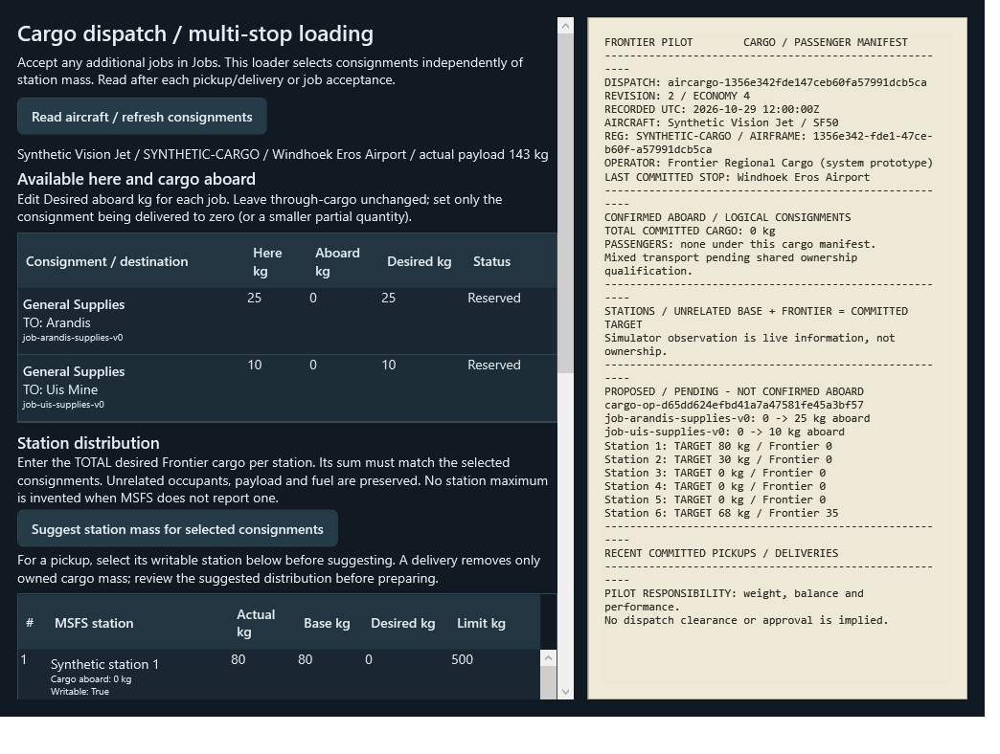
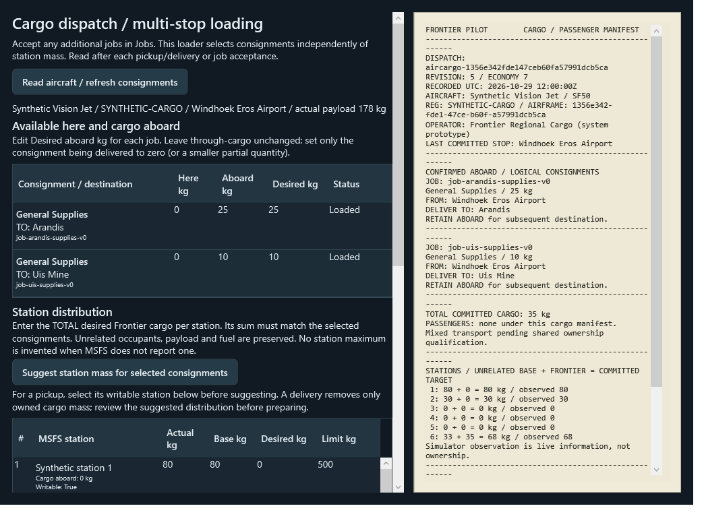
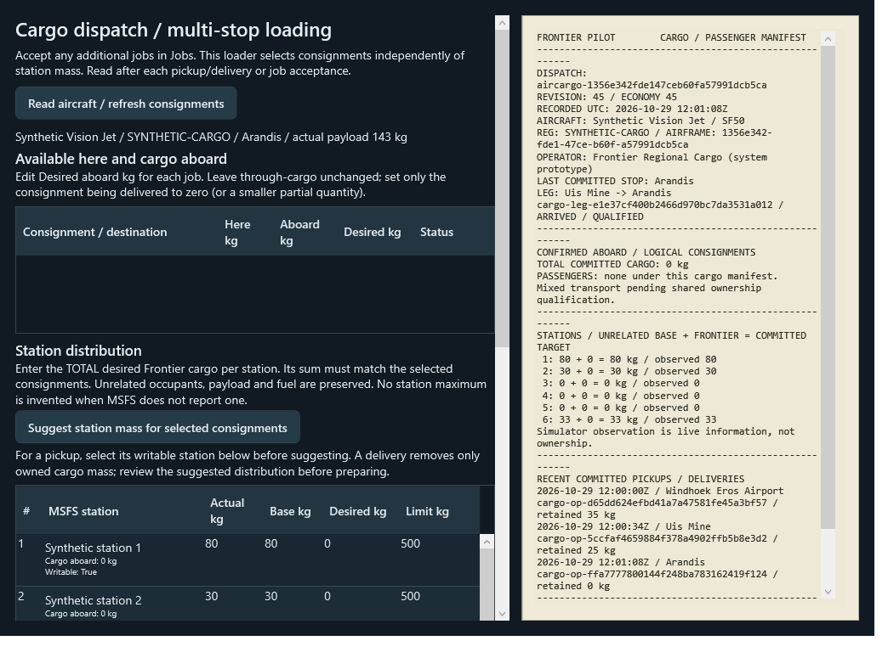

# Multi-stop cargo verification — 2026-10-29

**Automated evidence only; no live MSFS acceptance.** Draft [PR #6](https://github.com/MoneyWithMatt/frontier-pilot/pull/6) includes PR #3 baseline `f7df3ff`; original PR #3/#5 branches are untouched. No merge occurred.

## Validated runtime

- Source head: **`8b56d6f8dd5d76e50f88fdfcd3856794ed342ed6`**.
- [Hosted run 23](https://github.com/MoneyWithMatt/frontier-pilot/actions/runs/40961114914), clean tested PR merge **`fdda22edbebf09a85bd4729a7a8fca38dd309d9c`**.
- SDK **8.0.424**, complete Release solution: **0 warnings / 0 errors**.
- xUnit **816 executed / 816 passed / 0 failed / 0 skipped**. Increase from PR #3's 794: 21 cargo journey cases and one passenger gross-retry regression. Five earlier hard mass-policy assertions were replaced with approved advisory behavior while retaining identity/station constraints.
- **Nine verification guard scenarios**, `LoadingWpfSmoke`, `SiteUiSmoke`, packaging and both uploads passed. Actual cargo cell edits/buttons prove synthetic 35→25→0 kg, independent completions and unchanged unrelated mass/fuel. Actual destination bounds detect inherited row-height clipping. Existing passenger controls/once-only wage checks pass.

Hosted commands:
```powershell
./scripts/Invoke-Verification.ps1 -Stage BuildTest -DotnetPath dotnet
pwsh -NoProfile -File ./scripts/Test-VerificationGuards.ps1
./scripts/Invoke-Verification.ps1 -Stage Smoke -DotnetPath dotnet
./scripts/Invoke-Verification.ps1 -Stage Package -DotnetPath dotnet
```

Local clean source `8b56d6f` also passed 816/0/0, Release zero warnings/errors, using the existing pinned SDK via `scripts/Invoke-Verification.ps1 -Stage BuildTest -OutputDirectory .ci-output-multistop-07 -DotnetPath <existing-8.0.424-sdk>`. Focused shared transport cases passed **65/0/0** on the final precommit source. WPF was compiled locally and executed only on hosted Windows. Hosted checks need no MSFS/SDK installation, personal configuration, Community or saves.

## Artifact integrity

[Development artifact](https://github.com/MoneyWithMatt/frontier-pilot/actions/runs/40961114914/artifacts/12936670928), ZIP SHA256 `9c0fceccd48f9b1ef78260e86569e329241519cddab359fe94433ef730417abf`; not downloaded/executed locally. Download is not approval to run.

[Diagnostics](https://github.com/MoneyWithMatt/frontier-pilot/actions/runs/40961114914/artifacts/12936670938), ZIP SHA256 `52d68316ab8da30c84bf5079e85df53de2708123fca29404c2ede30fd91c9c34`, independently downloaded/hash-matched. Regression/smoke/package receipts report that exact clean merge, SDK 8.0.424 and Passed. TRX, guard/WPF logs and screenshots independently inspected. Artifacts have seven-day retention; public-safe screenshots below are retained here.

## Visual evidence

Resource, destination and job reference are readable together. Stations expose actual/base/desired mass and only reported limits. Proposed targets are separate from committed cargo. B remains after A delivery; final physical mass returns to the unrelated baseline. The supplementary station/action screenshot in diagnostics documents the loading/leg controls; complete dispatch sheets follow.






## Coverage and boundaries

`CargoJourneyTests` uses temporary JSON persistence and a synthetic guarded adapter. Coverage: explicit multi-resource/multi-destination quantities in one station, partial load/delivery, in-flight acceptance and intermediate pickup, through-leg proof, fixed rewards, once-per-leg wages after full delivery, partial setters/disconnect/restart, failed atomic replacement after readback, duplicate/manual conflicts, station refusal/clamp fixtures, aircraft/layout mismatch, overweight/CG advisory writes, passenger ownership exclusion, authorization/discard, schema-12 compatibility and manifest consistency. Arrival alone/partial delivery cannot release wages; a station echo without real gross effect cannot qualify by retrying identical targets. Equivalent passenger regression passes.

SDK findings/native integration do not establish live aircraft behavior. No mixed transport, passenger visuals, platform qualification or operational flight approval is claimed. [Focused live procedure](../../docs/multistop-cargo.md#live-simulator-acceptance) requires exact artifact/scenario approval and aircraft/SDK/simulator/config evidence.

## Preserved failures / superseded runs

- Initial local policy run: **789 pass / 5 fail / 0 skip**, old gross/payload/company-budget assertions. Corrected to the explicit product policy; station/identity rejection remains covered.
- Early compile repairs: params target typing, nonexistent fixture helper, internal ID helper access and one validation variable typo; corrected before runtime verification.
- Added in-flight test initially expected refusal for a valid unflown origin return: **17 pass / 1 fail / 0 skip**. Corrected the scenario to an unqualified later destination observation, asserting refusal and retained cargo. Initial and repaired local evidence remains available.
- [Run 20](https://github.com/MoneyWithMatt/frontier-pilot/actions/runs/40959148608): all stages passed, 810/0/0; diagnostic hash `a777b7b0811c5aa2ce7d044631f9d427c6fcd7f1dba193a3ef54164d3dc621b3` independently verified. Screenshot review found collapsed columns, subsequently fixed.
- [Run 21](https://github.com/MoneyWithMatt/frontier-pilot/actions/runs/40959492051): superseded/cancelled during WPF; regression/guards passed, packaging correctly skipped. Not final passing artifact evidence.
- [Run 22](https://github.com/MoneyWithMatt/frontier-pilot/actions/runs/40959724958): all stages passed, 812/0/0; diagnostic hash `603866d42263b4b359cf23931261120e7269ff770bf038da1cb081eefd90ee02` verified. Visual review found inherited 38-pixel rows clipping details; automatic row height and real bounds assertions pass in run 23.

No assertions were skipped/weakened to obtain green CI. Documentation-checkpoint status is tracked in PR #6; runtime/test source remains the commit above unless that PR records a subsequent implementation change.
