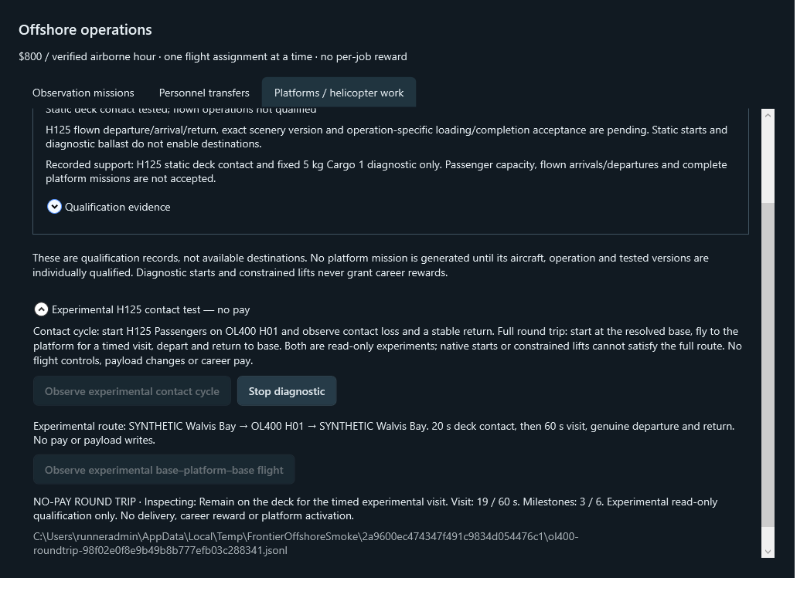
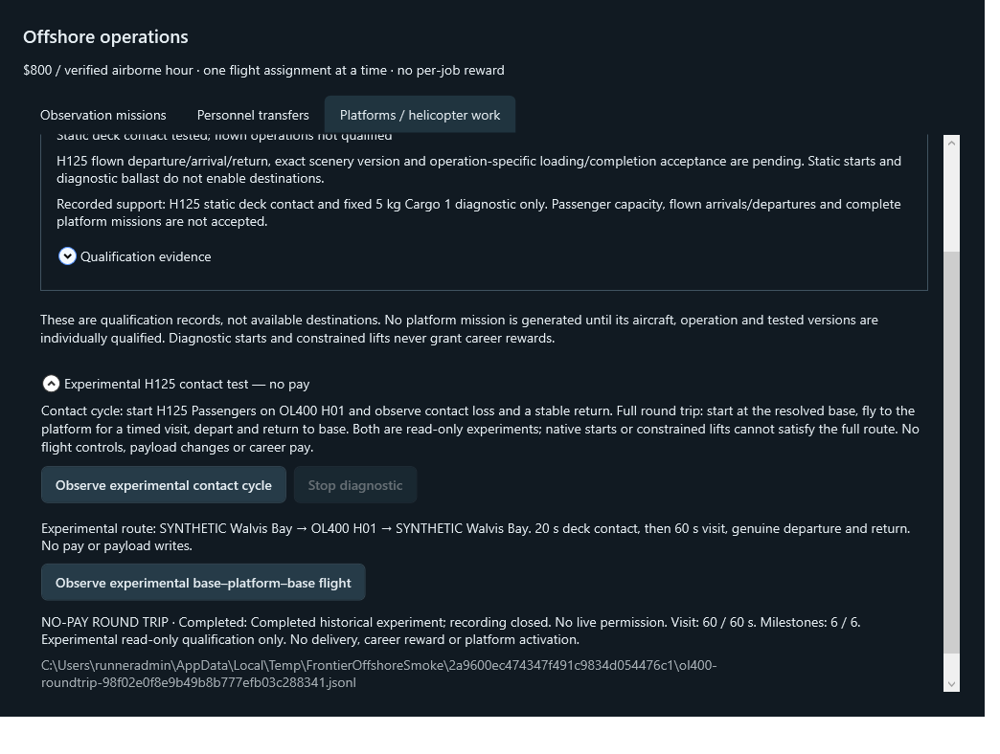

# H125 full-route qualification continuation

This extends PR #10's existing paid Vision Jet observation loop and shared passenger/platform foundations with a **read-only, no-pay H125 base → platform timed visit → base experiment**. No production H125 jobs, boarding profiles, loading writes, seated models or scenery changes enabled. The full Offshore career remains incomplete at its aircraft and live qualification gates.

## Exact automated results

Runtime head **d0c30c0e1d4e1ef16993786b4466f5ef62952542**, [hosted run69](https://github.com/MoneyWithMatt/frontier-pilot/actions/runs/41620017345), clean tested merge **113078393ffbbf9a23cc81ef97f34ea05fd1db21**: **970 passed / 0 failed / 0 skipped**, Windows2022/SDK8.0.424, Release zero warnings/errors. Nine verification guards, both WPF programs, offline CLI historical review, packaging and all three uploads passed. Clean regression/smoke/package receipts and970-caseTRX independently inspected; both WPF stderr logs empty. CLI receipt reports703syntheticframes, six historical milestones, completed/closed and both current presence flags false.

Commands on hosted Windows:

```powershell
./scripts/Invoke-Verification.ps1 -Stage BuildTest -DotnetPath dotnet
pwsh -NoProfile -File ./scripts/Test-VerificationGuards.ps1
./scripts/Invoke-Verification.ps1 -Stage Smoke -DotnetPath dotnet
dotnet src/App/bin/Release/net8.0/FrontierAirportBuilder.App.dll review-offshore-roundtrip .ci-output/screenshots/synthetic-offshore-roundtrip.jsonl
./scripts/Invoke-Verification.ps1 -Stage Package -DotnetPath dotnet
```

Local final BuildTest: PowerShell7 `scripts/Invoke-Verification.ps1 -Stage BuildTest -DotnetPath <existing-8.0.424-sdk> -OutputDirectory .ci-output-offshore-roundtrip-06`:970/0/0, zero warnings/errors, sourcea778a60 plus CLI/metadata implementation. Subsequent WPF fixture copy/workflow verification ran on hosted run69. Local WPF, diagnostic CLI and published app were not executed.22new unit cases versus948 baseline; existing cargo/passenger/fleet/save tests retained.

Preserved failures: roundtrip01 had two ambiguous target-typed TransportMonitor overload calls; explicit shared context fixed them.02 962/0/0;03 967/0/0;04 969/0/0 after late-takeoff regressions.05 CLI local variable shadowed existing top-level result; renamed roundTripResult.06 970/0/0. Logs/TRX preserved in ignored stage directories, no weakened assertions/skips. Hosted run67 passed967/0/0 plus allstages; run68 passed969/0/0 plus allstages. Latest run69 includes CLI integration and the final source.

## Verified artifacts — not executed locally

Seven-day retention, expires2026-11-10. New artifacts do not inherit earlier execution approvals.

- [Diagnostic CLI13222843607](https://github.com/MoneyWithMatt/frontier-pilot/actions/runs/41620017345/artifacts/13222843607), independently downloaded and matched ZIP SHA256 **c5599596be462d0c7c6e086398ae7ef66c166379c40f1960b73a39397cb2f8ee**. Included clean receipts identify1130783. Framework-dependent .NET8 x64 runtime/SDK required. Runtime modules are under `src/App/bin/Release/net8.0/` inside the ZIP.
- [Verification13222998292](https://github.com/MoneyWithMatt/frontier-pilot/actions/runs/41620017345/artifacts/13222998292), independently downloaded and matched SHA256 **aff040402dcdb903eb979d64a13e8ced994eec691353c8e7f2c888f2a0c0dd31**; receipts/TRX/CLIreview/screenshots inspected.
- [Desktop development13223377493](https://github.com/MoneyWithMatt/frontier-pilot/actions/runs/41620017345/artifacts/13223377493), GitHub ZIP digest `3ef51b9b83029c2300986fcbf3843ee9f2b4b09b79d6db4bc9da813637f48fee`. Not downloaded/executed. Desktop launch still needs isolated career stores.

Independently calculated run69 CLI module hashes:

| Module | SHA256 |
|---|---|
| FrontierAirportBuilder.App.dll | `4c900c8fd2be8caf3b2e45587db3b739b224f218a13ecb0fa26fa933363e2fbc` |
| FrontierAirportBuilder.Core.dll | `5f88926932625df6466a65284aad2421703d3cec07be8fd0bd8ef5edca37f2b7` |
| FrontierAirportBuilder.MsfsSdk.dll | `f0d711bc8c259661d1e0472482df34c48d93735d26b9e3070d422d06d03e7632` |
| FrontierAirportBuilder.Workflow.dll | `0f316728b4917b510e1d095edfbb971f92f05139186e943b8e76d6f755af896d` |

## Reviewed screenshots — actual WPF, synthetic native data

The same703 invented frames drive unit tests, actual WPF commands and CLI review. The source is named SYNTHETIC, not a real H125 flight. Inspection is20scontinuousdeck then60svisit; complete includes genuine-sequence input for both legs and six milestones. Duplicate start is disabled during capture; the unrelated synthetic career balance remains$30.89, with no experimental wages.





These images prove rendering/command integration only, not actual contact, flight, loading or platform qualification.

## Remaining live action / approval boundary

Fresh read-only desktop check in this continuation again captured existing MSFS1.9.21.0 at Start. Activation failed **“failed to activate captured window”**, refreshed returned window and retriedonce, same error. Stopped without click/key/bypass. No native recording, aircraft movement, payload/fuel/fault/scenery or personal game-save change. Async request to leave Windows unlocked/MSFSforeground is pending; do not assume the lock state from the error.

Read-only preflight metadata check found schema1airportcache with one savedFYWB entry, no explicit review document. No metadata files changed or copied into the repository. The CLI's existing strict catalogue resolver remains authoritative; the summary does not confer aircraft/platform qualification.

The repository [AGENTS.md](../../AGENTS.md) states: “New/modified executable artifacts do not inherit approval to run locally. Later allowlisted scenario approval is separate from artifact approval.” Exact run69 CLI artifact and bounded read-only record/review scenario require approval; the earlier approved run59 scenario does not cover this CLI. No subsequent documentation rebuild may be substituted.

Once access and approval exist: use only the exact module/archive hashes above, existing x64dotnet and SDK; read explicit existing destination metadata, create a fresh private output path, run `record-offshore-roundtrip` bounded1200s alongside an actual H125FYWB→OL400→FYWB test. No controller is included. Normal aircraft movements must be actually controlled and observed; a native pad start/constrained lift cannot complete this full-route experiment. `review-offshore-roundtrip` is allowed only for its newly captured private log/context and never pays/promotes. No Desktop candidate/personal career launch, payload/fault/fuel/position/freeze commands, scenery installation or merge in this allowlist.

Successful real recordings still need human review of exact aircraft/scenery versions before registry promotion and subsequent operation-specific handling tests. Vision Jet boarding remains blocked by effective configuration; H125 passenger/supply missions remain unimplemented as active production jobs. [Implementation and procedure](../../docs/offshore-missions.md), [handoff](../../docs/handoffs/offshore-missions.md).
