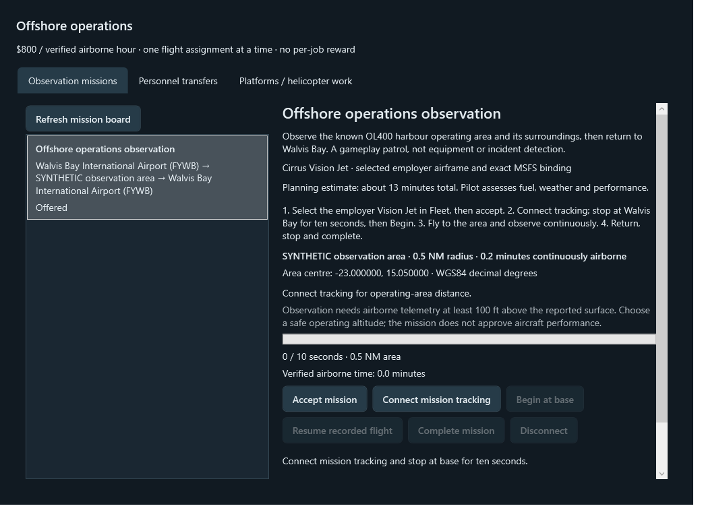
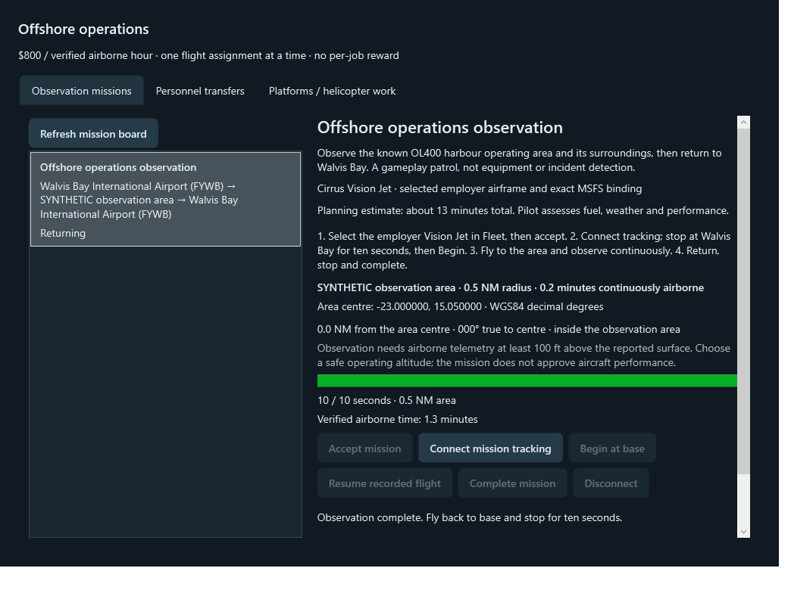
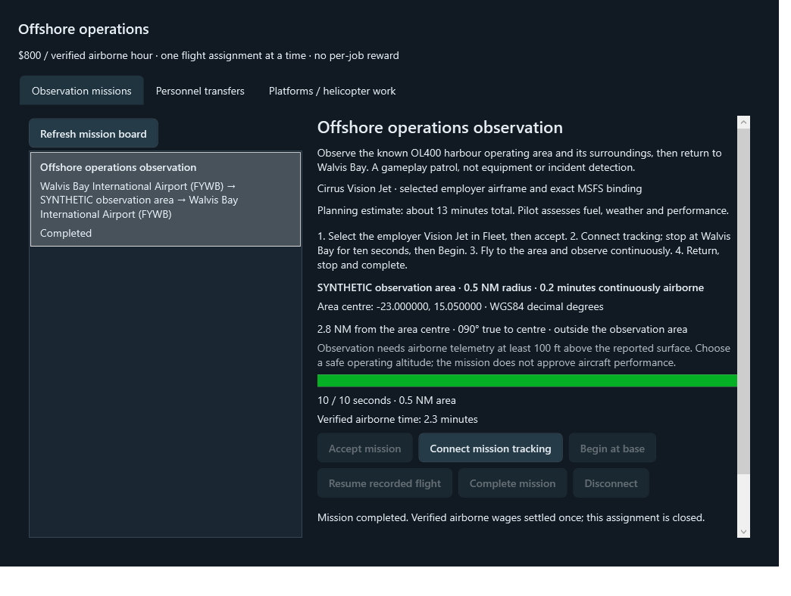
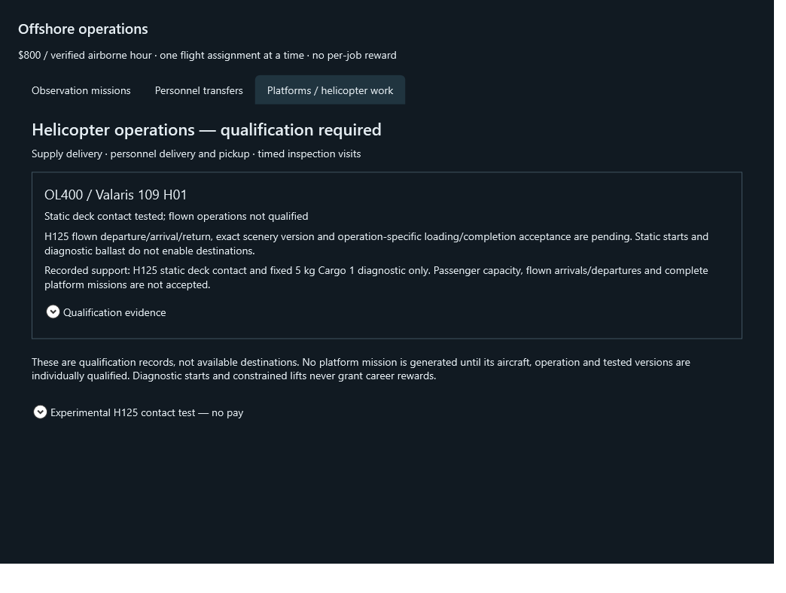

# Offshore missions: automated verification

Runtime head **5a46a040dc125fc93952a353b23af89e3fb2af4a**, draft [PR #10](https://github.com/MoneyWithMatt/frontier-pilot/pull/10), based on PR #8 `47698b1`. No merges or changes to other branches.

[Hosted run65](https://github.com/MoneyWithMatt/frontier-pilot/actions/runs/41601718648) tested clean merge **19bc0eadc77501b14a61cecc2fe572f59a8a82fb**, Windows2022 / SDK8.0.424: **948 passed / 0 failed / 0 skipped**, Release zero warnings/errors, nine verification guards, both WPF programs, packaging and uploads passed. Regression/smoke/package receipts and TRX independently inspected; both WPF stderr logs empty. No unresolved failures in this checkpoint.

Exact hosted commands:

```powershell
./scripts/Invoke-Verification.ps1 -Stage BuildTest -DotnetPath dotnet
pwsh -NoProfile -File ./scripts/Test-VerificationGuards.ps1
./scripts/Invoke-Verification.ps1 -Stage Smoke -DotnetPath dotnet
./scripts/Invoke-Verification.ps1 -Stage Package -DotnetPath dotnet
```

Local final: PowerShell7 `scripts/Invoke-Verification.ps1 -Stage BuildTest -DotnetPath <existing-8.0.424-sdk> -OutputDirectory .ci-output-offshore-missions-13`, source05e14c6 plus final status/render assertions: **948/0/0**, zero warnings/errors. Earlier compile/fixture/gap-timer failures preserved in the [handoff](../../docs/handoffs/offshore-missions.md); no skips/weakened assertions. Existing cargo, passenger, fleet and save regressions remain in the complete suite.

## Downloaded artifacts, not executed

Seven-day retention, expires2026-11-10. Downloading/checksumming does not approve local execution.

- [Development13215455810](https://github.com/MoneyWithMatt/frontier-pilot/actions/runs/41601718648/artifacts/13215455810), ZIP SHA256 `34b90ac964c6b03dffbe603f4bf6fa260fb363a93be2c4d3c4ee00c42c313ad0` independently matched. All11 `SHA256SUMS.txt` entries independently matched. `application/FrontierPilot.exe` SHA256 **b3c0486b40805db2a103ba883042f9cffecfee1835bedb1b088546708560e014**. `build.json` identifies clean19bc0ea and simulatorVerification=Not performed. No candidate executable launched or normal distribution replaced.
- [Diagnostics13214911362](https://github.com/MoneyWithMatt/frontier-pilot/actions/runs/41601718648/artifacts/13214911362), ZIP SHA256 `c9b423926598a54eac22c6be47c15cecb3c800cd6eb692ec304c25d52fa0a933` independently matched; receipts/TRX/screenshots inspected.

Earlier milestones run62 (932/0/0), run63 (947/0/0), run64 (948/0/0) passed full Windows pipeline. Run64 screenshots revealed a stale captured return display and completed-status prompt; runtime5a46a04 fixes the prompt, waits for WPF updates and explicitly asserts rendered Returning/progress and settled completion text. Run65 images below were reviewed. No failed assertion was suppressed to fix capture timing.

## Production WPF with synthetic stores and telemetry

These are actual production controls driven by a synthetic fixture: **0.5 NM / 10 seconds**, invented test coordinates, synthetic Vision Jet identity and temporary/memory stores. Production authored area is **5 NM / 300 seconds** at researched OL400 geography. These images are not simulator flight, payload or platform acceptance. The test's139eligible airborne seconds produce exactly$30.89 at$800/hour, once.

### Offered observation



### Observation complete, return required



### Returned and settled



### Platform restrictions



The platform image is byte-identical to reviewed run64. Every current landing operation remains unavailable.

## Live boundary / fresh access check

No new aircraft flight, native mission telemetry, physical payload or passenger-model acceptance for this branch. Historical PR #9 static contact/fixed5kg remains separate. SF50/H125 effective configuration is archived/unavailable; no guessed seats/profiles or visible-person claims.

Read-only desktop check2026-11-03 used the computer-use skill: existing MSFS1.9.21.0 window returned and Start screen captured. Explicit activation failed **“failed to activate captured window”**. Refreshed list_windows/get_window selection and retried once, same failure; stopped UI interaction. No click/key, simulator setup, flight, payload/fuel/fault/scenery/personal-save change or candidate launch. The menu background is not evidence of the currently loaded aircraft/configuration. This confirms an access blocker, not a landing-detection failure.

[Focused live procedure / configuration gates](../../docs/offshore-missions.md). Exact-build and allowlisted-scenario approval plus isolated profile/reviewed temporary stores remain required. Previous run59 constrained-lift approval does not transfer to this artifact. The full requested Offshore career is not complete at these physical/live qualification boundaries.
